<picture>
  <source media="(prefers-color-scheme: dark)" srcset="./assets/hero-dark.svg">
  <source media="(prefers-color-scheme: light)" srcset="./assets/hero-light.svg">
  
</picture>

 

<picture>
  <source media="(prefers-color-scheme: dark)" srcset="https://raw.githubusercontent.com/satriadhikara/satriadhikara/output/neofetch-dark.svg">
  <source media="(prefers-color-scheme: light)" srcset="https://raw.githubusercontent.com/satriadhikara/satriadhikara/output/neofetch-light.svg">
  
</picture>

### `$ ls ~/projects`

- **[DBRepo](https://github.com/DBRepo-Project/dbrepo)** · contributor. Research-data repository that versions every query, timestamp and result checksum, so any subset can be cited and reproduced. `java` `helm` `docker`
- **[kolumba](https://github.com/satriadhikara/kolumba)** · JMAP-native webmail for Stalwart with no IMAP shim. One batched request creates and sends an email. `typescript` `tanstack start`
- **[jejak](https://github.com/satriadhikara/jejak)** · Samples Street View along a walking route and has Gemini grade the sidewalks, crossings and lighting. Gemastik 2025 finalist. `expo` `hono`
- **[dock](https://github.com/satriadhikara/dock)** · Contract lifecycle for port logistics: rich-text editor, draft-to-signature flow, AI contract assistant. 2nd, IFest 2025. `next.js` `hono` `fastapi`
- **[babyblooms](https://github.com/satriadhikara/babyblooms)** · Pregnancy companion that links mother and partner accounts. 5th, Hack4Health IEEE ITB 2024. `expo` `hono`

  <a href="https://satriadhikara.com"><code>satriadhikara.com</code></a> ·
  <a href="mailto:hello@satriadhikara.com"><code>hello@satriadhikara.com</code></a> ·
  <a href="https://www.linkedin.com/in/satriadhikara"><code>linkedin</code></a>
   
  banner and card are drawn by <a href="./scripts">zero-dependency python</a>; stats refresh daily via GitHub Actions

